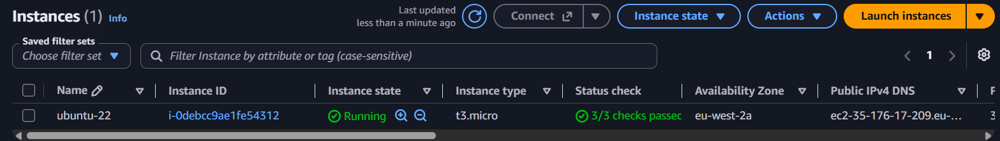
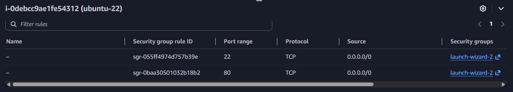

# Networking: Domain + NGINX on EC2

## What I built
Bought a domain on Cloudflare, launched an Ubuntu EC2 instance, installed
NGINX, and pointed an A record at the instance so the NGINX landing page
loads over my own domain.

Architecture: Browser → DNS (Cloudflare) → EC2 public IP → Security group
(port 80) → NGINX

## Steps
1. Bought domain on Cloudflare
2. Launched EC2 (Ubuntu), configured security group (SSH 22, HTTP 80)
3. Installed and enabled NGINX
4. Created A record (@ → EC2 public IPv4) and CNAME (www → root domain)
5. Verified with dig, curl and the browser

## What I learnt
- LAN/WAN, IP vs MAC, TCP vs UDP, OSI and TCP/IP (see notes/)
- How DNS resolves a name: resolver → root → TLD → authoritative
- Why A records, CNAMEs and TTL matter
- Security groups act as a virtual firewall for EC2

## Challenges and how I solved them
| Problem | Cause | Fix |

| Domain didn't load | A record pointed at my local machine's IP, not EC2 | Pointed it at the EC2 public IPv4 |
| Cloudflare error 521 | NGINX wasn't on the EC2 instance and port 80 was closed | Installed NGINX on EC2 and added an HTTP rule |
| EC2 Instance Connect failed | SSH rule limited to My IP; the browser connect tool uses AWS IPs | Allowed SSH from 0.0.0.0/0 for the exercise |

## Screenshots

